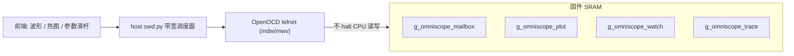

# OmniScope 嵌入式 SDK 文档（`OmniScope::Embedded`）

面向 STM32 / Cortex-M 等裸机与 RTOS 工程的纯 C99 调试组件库。
固件在 SRAM 中声明带魔数的调试结构，上位机经 OpenOCD SWD **不 halt CPU** 地读写，实现在线调参、波形推送、变量监视与瞬态抓取。零第三方依赖，`plot.h` / `watch.h` 为 header-only（全 `static inline`）。

- 车载工控机 C++ 版请见：[`../cpp/README.md`](../cpp/README.md)
- 双版本对比与 CMake 引入总览请见：[`../README.md`](../README.md)

**目录**

- [1. 核心组件](#1-核心组件)
- [2. 核心功能](#2-核心功能)
- [3. API 参考](#3-api-参考)
  - [3.1 mailbox 调参邮箱](#31-mailbox-调参邮箱)
  - [3.2 trace 高速迹缓冲](#32-trace-高速迹缓冲)
  - [3.3 seqlock 原子快照](#33-seqlock-原子快照)
  - [3.4 plot 命名通道推送（header-only）](#34-plot-命名通道推送header-only)
  - [3.5 watch 监视与参数表（header-only）](#35-watch-监视与参数表header-only)
- [4. 综合示例（一段代码覆盖全部 API）](#4-综合示例一段代码覆盖全部-api)
- [5. 与上位机配合](#5-与上位机配合)
- [6. 构建集成](#6-构建集成)

---

## 1. 核心组件



| 组件 | 头文件 | 实现 | 作用 |
|---|---|---|---|
| 调参邮箱 | `omniscope/mcu/mailbox.h` | `src/mailbox.c` | 16 槽浮点参数 + 状态握手（旧路径调参） |
| 高速迹缓冲 | `omniscope/mcu/mailbox.h` | `src/mailbox.c` | 4 通道 × 256 点环形采样 + 触发标记 |
| 原子快照 | `omniscope/mcu/mailbox.h` | `src/mailbox.c` | SeqLock 多变量一致性快照 |
| 命名通道推送 | `omniscope/mcu/plot.h` | header-only | 16 命名通道 × 512 点 FIFO，调用即"发送" |
| 监视与参数表 | `omniscope/mcu/watch.h` | header-only | 32 项统一表：只读监视 + 大数组 + 滑杆参数 |

所有结构体均带 `magic` + `version` 头，内存布局用 `_Static_assert` 锁死，上位机 Python 解码器按相同偏移解析。

## 2. 核心功能

1. **零停机调试**：上位机经 OpenOCD telnet（`mdw`/`mwv`/`mww`）直接访问 SRAM，CPU 全程运行，ISR 不打断。
2. **ELF 符号自动发现**：固件按约定命名全局变量 `g_omniscope_plot` / `g_omniscope_watch` / `g_omniscope_mailbox`，上位机从 ELF 符号表取地址，无需手填。
3. **在线调参（两条路径）**：
   - 新路径 `watch` 参数项：上位机渲染滑杆，`mww` 直写变量并钳制到 `[min, max]`，固件零干预；
   - 旧路径 `mailbox`：上位机改写槽位并置 `HOST_DIRTY`，固件轮询取出后 `acknowledge` 应答。
4. **波形推送**：`OMNISCOPE_PLOT` 一行写入命名通道 FIFO；上位机按单调序号排空并回写 `read_seq`，固件据此统计 `dropped`（被覆盖的未读点数）。
5. **变量监视**：只读标量上位机默认 30Hz 轮询；大数组（雷达回波矩阵等）采用版本号门控——每轮只读 4B 版本号，变化才分块拉取 payload 并渲染热图。
6. **瞬态抓取**：1kHz+ ISR 中向 trace 环写 4 通道采样，`omniscope_trace_trigger` 打触发标记，上位机抓取触发点前后波形。
7. **带宽调度**：上位机滚动 1s 字节计量，总额度默认 8 KB/s（门户可调），硬优先级 `参数回读(1Hz) > 监视标量(30Hz) > plot 排空(空闲) > 数组 payload(空闲)`。

## 3. API 参考

约定：纯 C99；`plot.h` / `watch.h` 全部 API 为 `static inline`；返回值 `int` 的注册函数返回索引（≥0）或 -1（表满/参数非法）。

### 3.1 mailbox 调参邮箱

```c
#include <omniscope/mcu/mailbox.h>
```

**结构体**（驻留 SRAM，上位机按符号 `g_omniscope_mailbox` 发现）：

```c
typedef struct {
    uint32_t magic;        /* "OMSC" 0x4F4D5343 */
    uint32_t version;      /* 1 */
    volatile uint32_t seq;        /* 每次更新自增 */
    volatile uint32_t status;     /* OMNISCOPE_STATUS_* */
    volatile float params[16];    /* 参数槽位 */
    uint32_t reserved[4];
} omniscope_mailbox_t;
```

**状态宏**：`OMNISCOPE_STATUS_IDLE`(0)、`OMNISCOPE_STATUS_HOST_DIRTY`(1，上位机已改写)、`OMNISCOPE_STATUS_MCU_APPLIED`(2，固件已应用)、`OMNISCOPE_STATUS_SAVE_FLASH`(4，请求落盘 Flash)。

---

#### `omniscope_mailbox_init`

```c
void omniscope_mailbox_init(omniscope_mailbox_t *mb);
```

初始化邮箱（写魔数、清零槽位）。启动时调用一次。

---

#### `omniscope_mailbox_has_update`

```c
bool omniscope_mailbox_has_update(const omniscope_mailbox_t *mb);
```

**Returns** — 上位机是否经 SWD 改写了参数（`HOST_DIRTY` 置位）。

---

#### `omniscope_mailbox_get_param` / `set_param`

```c
float omniscope_mailbox_get_param(const omniscope_mailbox_t *mb,
                                  uint32_t index, float default_val);
void omniscope_mailbox_set_param(omniscope_mailbox_t *mb,
                                 uint32_t index, float value);
```

读 / 写槽位 `index`（0~15）。`get_param` 在索引越界时返回 `default_val`。`set_param` 用于固件侧写入初值供上位机回显。

---

#### `omniscope_mailbox_acknowledge`

```c
void omniscope_mailbox_acknowledge(omniscope_mailbox_t *mb);
```

应答：清 `HOST_DIRTY`、置 `MCU_APPLIED`，通知上位机参数已生效。

**Example**

```c
if (omniscope_mailbox_has_update(&g_omniscope_mailbox)) {
    pid_kp = omniscope_mailbox_get_param(&g_omniscope_mailbox, 0, pid_kp);
    omniscope_mailbox_acknowledge(&g_omniscope_mailbox);
}
```

### 3.2 trace 高速迹缓冲

```c
#define OMNISCOPE_TRACE_CHANNELS    4U
#define OMNISCOPE_TRACE_BUFFER_SIZE 256U

typedef struct {
    volatile uint32_t head;           /* 写指针（单调递增） */
    volatile uint32_t triggered;      /* 1 = 触发事件已发生 */
    volatile uint32_t trigger_index;  /* 触发点所在缓冲下标 */
    uint32_t buffer_size;
    omniscope_trace_point_t samples[256];  /* {timestamp_us, channels[4]} 20B/点 */
} omniscope_trace_buffer_t;
```

---

#### `omniscope_trace_init` / `record` / `trigger`

```c
void omniscope_trace_init(omniscope_trace_buffer_t *buf);
void omniscope_trace_record(omniscope_trace_buffer_t *buf, uint32_t timestamp_us,
                            const float channels[OMNISCOPE_TRACE_CHANNELS]);
void omniscope_trace_trigger(omniscope_trace_buffer_t *buf);
```

- `record`：环形写入一组 4 通道采样，可在 1kHz ~ 10kHz ISR 中调用（纯 SRAM 操作，不占 SWD 带宽）。
- `trigger`：标记触发事件，上位机抓取触发点前后波形做瞬态分析。

### 3.3 seqlock 原子快照

保护"多个变量需一致读取"的场景（如上位机读一组相关标量时固件恰好写到一半）。

```c
void     omniscope_seqlock_init(omniscope_seqlock_t *lock);
void     omniscope_seqlock_write_begin(omniscope_seqlock_t *lock);  /* 写前: seq++ (奇) */
void     omniscope_seqlock_write_end(omniscope_seqlock_t *lock);    /* 写后: seq++ (偶) */
uint32_t omniscope_seqlock_read_begin(const omniscope_seqlock_t *lock);
bool     omniscope_seqlock_read_retry(const omniscope_seqlock_t *lock, uint32_t start_seq);
```

**读侧模式**：`start = read_begin()` → 读变量组 → `read_retry(lock, start)` 为 `true`（起始序号为奇、或序号已变）则重读。

### 3.4 plot 命名通道推送（header-only）

```c
/* 可选: include 前覆盖时间戳源, 默认 0 (上位机退化为接收时刻) */
#define OMNISCOPE_PLOT_TIMESTAMP_US() (HAL_GetTick() * 1000U)
#include <omniscope/mcu/plot.h>

omniscope_plot_t g_omniscope_plot;   /* 约定符号名, 上位机自动发现 */
```

**容量宏**：`OMNISCOPE_PLOT_MAX_CHANNELS` 16、`OMNISCOPE_PLOT_NAME_LEN` 24、`OMNISCOPE_PLOT_FIFO_SIZE` 512（2 的幂）。整表 8668B SRAM。

**内存布局**（上位机对齐依据，`_Static_assert` 锁定）：

| 偏移 | 字段 |
|---|---|
| 0 / 4 / 8 | magic `"OMPL"` / version / `write_seq` |
| 12 / 16 | `read_seq`（上位机回写）/ `dropped`（丢点计数） |
| 20 / 24 | `fifo_size` / `channel_count` |
| 28 | `channels[16]`：`char name[24]; u32 active`（28B/项） |
| 476 | `points[512]`：`{seq, ts_us, channel, value}`（16B/点） |

---

#### `omniscope_plot_init`

```c
static inline void omniscope_plot_init(omniscope_plot_t *plot);
```

初始化 FIFO（写魔数与容量）。启动时调用一次。

---

#### `omniscope_plot_channel`

```c
static inline int omniscope_plot_channel(omniscope_plot_t *plot, const char *name);
```

按名注册（或查找）通道，幂等。**Returns** — 通道索引 ≥0；满 16 通道或参数非法返回 -1。

---

#### `omniscope_plot_push`

```c
static inline void omniscope_plot_push(omniscope_plot_t *plot, uint32_t channel,
                                       float value, uint32_t ts_us);
```

推入一个采样点（单写者安全）。上位机落后一整环时，被覆盖点计入 `dropped`（需上位机已回写 `read_seq`）。

---

#### `OMNISCOPE_PLOT`（推荐的一行宏）

```c
OMNISCOPE_PLOT(plot_ptr, name, value);
```

通道索引缓存于函数内 `static` 变量，首次调用自动注册通道，之后仅一次 FIFO push；时间戳取自 `OMNISCOPE_PLOT_TIMESTAMP_US()`。

**Example**

```c
OMNISCOPE_PLOT(&g_omniscope_plot, "gimbal.yaw", yaw_deg);
OMNISCOPE_PLOT(&g_omniscope_plot, "gimbal.pitch", pitch_deg);
```

### 3.5 watch 监视与参数表（header-only）

```c
#include <omniscope/mcu/watch.h>

omniscope_watch_table_t g_omniscope_watch;   /* 约定符号名, 上位机自动发现 */
```

**类型枚举** `OMNISCOPE_TYPE_*`：`F32`(0)、`I32`(1)、`U32`(2)、`I16`(3)、`U16`(4)、`I8`(5)、`U8`(6)。
**条目类别** `OMNISCOPE_KIND_*`：`MONITOR`(0，恒只读) / `PARAM`(1，恒可写)。
**访问权限** `OMNISCOPE_ACCESS_*`：`RO`(0) / `RW`(1)。

**布局**：表头 16B（magic `"OMWT"` / version / count / capacity）；表项 52B（`name[24]`@0、`ptr`@24、`elem_type/kind/access/flags`@28、`rows/cols`@32、`version`@36、`min/max/step`@40）；容量 `OMNISCOPE_WATCH_MAX_ENTRIES` 32，整表 1680B。

---

#### `omniscope_watch_init`

```c
static inline void omniscope_watch_init(omniscope_watch_table_t *table);
```

初始化表（写魔数与容量）。启动时调用一次。

---

#### `omniscope_watch_register_param`

```c
static inline int omniscope_watch_register_param(omniscope_watch_table_t *table,
                                                 const char *name, volatile void *ptr,
                                                 uint8_t elem_type,
                                                 float min, float max, float step);
```

注册可调参数（RW 标量）。上位机渲染滑杆，`mww` 直写 `*ptr` 并钳制到 `[min, max]`，1Hz 回显。**被指向变量必须声明为 `volatile` 且驻留 SRAM**（SWD 绕过 CPU 直写内存）。

---

#### `omniscope_watch_register_scalar`

```c
static inline int omniscope_watch_register_scalar(omniscope_watch_table_t *table,
                                                  const char *name, volatile void *ptr,
                                                  uint8_t elem_type);
```

注册只读监视标量（`MONITOR` + `RO`）。上位机默认 30Hz 轮询；UI 无写入入口，后端 403 拦截写入。

---

#### `omniscope_watch_register_array`

```c
static inline int omniscope_watch_register_array(omniscope_watch_table_t *table,
                                                 const char *name, volatile void *ptr,
                                                 uint8_t elem_type,
                                                 uint16_t rows, uint16_t cols);
```

注册大数组监视（恒只读，`rows × cols` 个元素）。上位机按版本号门控分块拉取并渲染热图。**数据更新完成后必须调用 `omniscope_watch_touch`**，否则上位机不会重读 payload。

---

#### `omniscope_watch_set_range` / `touch`

```c
static inline void omniscope_watch_set_range(omniscope_watch_table_t *table,
                                             uint32_t idx, float min, float max);
static inline void omniscope_watch_touch(omniscope_watch_table_t *table, uint32_t idx);
```

- `set_range`：设置热图色标上下限（0 = 自适应）。
- `touch`：版本号自增，通知上位机重读该数组 payload。

---

#### `omniscope_watch_register_ex`（全参数底层形式）

```c
static inline int omniscope_watch_register_ex(omniscope_watch_table_t *table,
                                              const char *name, volatile void *ptr,
                                              uint8_t elem_type, uint8_t kind,
                                              uint8_t access, uint16_t rows, uint16_t cols,
                                              float min, float max, float step);
```

上述三个便捷函数的共同后端，需要自定义 kind/access 时使用。

---

#### `omniscope_type_size`

```c
static inline uint8_t omniscope_type_size(uint8_t elem_type);
```

**Returns** — 类型字节数（1/2/4），非法类型返回 0。

## 4. 综合示例（一段代码覆盖全部 API）

```c
/* omni_demo.c — OmniScope 嵌入式 SDK 全 API 演示 (STM32 + FreeRTOS) */
#include "main.h"
#include "cmsis_os.h"

/* OMNISCOPE_PLOT 宏的时间戳源: 必须在 include 前定义;
 * HAL_GetTick 为 1ms 分辨率, 需要真微秒可改用 DWT->CYCCNT / (SystemCoreClock/1MHz) */
#define OMNISCOPE_PLOT_TIMESTAMP_US() (HAL_GetTick() * 1000U)

#include <omniscope/mcu/mailbox.h>   /* 邮箱 + 迹缓冲 + seqlock */
#include <omniscope/mcu/plot.h>      /* 命名通道推送 (header-only) */
#include <omniscope/mcu/watch.h>     /* 监视与参数表 (header-only) */

/* ============ 1. 约定符号全局变量: 必须驻留 SRAM, 上位机按名自动发现 ============ */
omniscope_mailbox_t      g_omniscope_mailbox;
omniscope_trace_buffer_t g_omniscope_trace;
omniscope_plot_t         g_omniscope_plot;
omniscope_watch_table_t  g_omniscope_watch;
static omniscope_seqlock_t s_snapshot_lock;

/* ============ 2. 被监视 / 被调变量: 必须 volatile (SWD 绕过 CPU 直写) ============ */
volatile float    g_pid_kp      = 1.0f;   /* watch 参数项: 上位机滑杆 0~10 直写 */
volatile uint32_t g_uptime_s    = 0;      /* watch 只读标量: 30Hz 轮询 */
volatile float    g_yaw_deg     = 0.0f;   /* 受控量, 同时进 plot/trace */
static float      g_echo[8][8];           /* watch 大数组: 版本门控热图 */

/* 受 seqlock 保护的一组相关变量 (上位机读一致性快照) */
volatile float g_pos_x = 0, g_pos_y = 0, g_pos_z = 0;

static int s_echo_idx = -1;               /* echo 在 watch 表中的索引 */

/* ============ 3. 初始化: 外设就绪后、任务启动前调用一次 ============ */
static void OmniDemo_Init(void)
{
    /* mailbox 邮箱: 槽位 0=kp 写入初值供上位机回显 */
    omniscope_mailbox_init(&g_omniscope_mailbox);
    omniscope_mailbox_set_param(&g_omniscope_mailbox, 0, g_pid_kp);

    /* trace 迹缓冲 */
    omniscope_trace_init(&g_omniscope_trace);

    /* seqlock */
    omniscope_seqlock_init(&s_snapshot_lock);

    /* plot 命名通道 FIFO (通道由 OMNISCOPE_PLOT 首次调用时自动注册) */
    omniscope_plot_init(&g_omniscope_plot);

    /* watch 表: 参数项 + 只读标量 + 大数组 */
    omniscope_watch_init(&g_omniscope_watch);
    omniscope_watch_register_param(&g_omniscope_watch, "pid.kp", &g_pid_kp,
                                   OMNISCOPE_TYPE_F32, 0.0f, 10.0f, 0.1f);
    omniscope_watch_register_scalar(&g_omniscope_watch, "sys.uptime_s", &g_uptime_s,
                                    OMNISCOPE_TYPE_U32);
    omniscope_watch_register_scalar(&g_omniscope_watch, "gimbal.yaw", &g_yaw_deg,
                                    OMNISCOPE_TYPE_F32);
    s_echo_idx = omniscope_watch_register_array(&g_omniscope_watch, "radar.echo",
                                                &g_echo[0][0],
                                                OMNISCOPE_TYPE_F32, 8, 8);
    omniscope_watch_set_range(&g_omniscope_watch, (uint32_t)s_echo_idx, 0.0f, 8.0f);
}

/* ============ 4. 任务循环: 100Hz ============ */
static void OmniDemo_Loop(void)
{
    /* 4.1 mailbox 旧路径: 上位机改写槽位 -> HOST_DIRTY -> 取出 -> 应答 */
    if (omniscope_mailbox_has_update(&g_omniscope_mailbox)) {
        g_pid_kp = omniscope_mailbox_get_param(&g_omniscope_mailbox, 0, g_pid_kp);
        omniscope_mailbox_acknowledge(&g_omniscope_mailbox);
    }
    /* 新路径: g_pid_kp 已被上位机经 watch 参数项直写, 直接使用即可 */

    /* 4.2 业务演算 (演示: 让 yaw 缓慢转动) */
    g_yaw_deg += 0.1f * g_pid_kp;
    if (g_yaw_deg > 180.0f) { g_yaw_deg = -180.0f; }
    g_uptime_s = HAL_GetTick() / 1000U;

    /* 4.3 seqlock 保护的多变量写入 */
    omniscope_seqlock_write_begin(&s_snapshot_lock);
    g_pos_x = g_yaw_deg; g_pos_y = g_pid_kp; g_pos_z = (float)g_uptime_s;
    omniscope_seqlock_write_end(&s_snapshot_lock);

    /* 4.4 plot 波形推送: 20Hz 节流, 避免撑爆上位机带宽预算 */
    static uint32_t s_plot_div = 0;
    if (++s_plot_div >= 5U) {
        s_plot_div = 0;
        OMNISCOPE_PLOT(&g_omniscope_plot, "gimbal.yaw", g_yaw_deg);
        OMNISCOPE_PLOT(&g_omniscope_plot, "pid.kp", g_pid_kp);
    }

    /* 4.5 大数组更新 + touch 版本号 (10Hz 节流): host 仅在版本变化后重拉 payload */
    static uint32_t s_touch_div = 0;
    if (++s_touch_div >= 10U) {
        s_touch_div = 0;
        uint32_t t = HAL_GetTick() / 100U;
        for (uint32_t y = 0; y < 8U; ++y)
            for (uint32_t x = 0; x < 8U; ++x)
                g_echo[y][x] = (float)((x * 7U + y * 13U + t) % 16U) * 0.5f;
        omniscope_watch_touch(&g_omniscope_watch, (uint32_t)s_echo_idx);
    }
}

/* ============ 5. 1kHz 控制 ISR: trace 记录 + 触发标记 ============ */
void Control_ISR(void)
{
    float channels[OMNISCOPE_TRACE_CHANNELS] = {
        180.0f,        /* ch0 目标角度 */
        g_yaw_deg,     /* ch1 实际角度 */
        180.0f - g_yaw_deg,  /* ch2 误差 */
        g_pid_kp       /* ch3 增益 */
    };
    omniscope_trace_record(&g_omniscope_trace, HAL_GetTick() * 1000U, channels);

    /* 误差过阈值打触发标记, 上位机抓取触发点前后 256 点波形 */
    if (180.0f - g_yaw_deg > 90.0f) {
        omniscope_trace_trigger(&g_omniscope_trace);
    }
}

/* ============ 6. FreeRTOS 任务入口 ============ */
void OmniDemo_Task(void const *argument)
{
    (void)argument;
    OmniDemo_Init();          /* 亦可在 main() 外设初始化后直接调用 */
    for (;;) {
        OmniDemo_Loop();
        osDelay(10);          /* configTICK_RATE_HZ=1000 -> 10ms -> 100Hz */
    }
}
```

## 5. 与上位机配合

```bash
# 1. 烧录固件后启动 OpenOCD (保持运行, 提供 telnet 4444)
openocd -f stm32f4discovery.cfg

# 2. 启动 OmniScope 上位机门户
./host/start.sh --port 8080

# 3. 浏览器打开 http://127.0.0.1:8080/ 进入 SWD 页, 选择工程目录定位最新 ELF
```

上位机 `swd.py` 自动解析 ELF 符号 `g_omniscope_plot` / `g_omniscope_watch` / `g_omniscope_mailbox`，启用对应面板；带宽调度器按 `参数(1Hz) > 监视标量(30Hz) > plot 排空 > 数组 payload` 分配默认 8 KB/s 额度。

**固件侧注意事项**：

- 被监视/被调变量必须 `volatile` 且驻留 SRAM（勿放 CCMRAM 之外不可用区；全局/静态变量默认满足）。
- `OMNISCOPE_PLOT` 推送与 `omniscope_watch_touch` 建议降频（plot ≤ 20Hz、大数组 touch ≤ 10Hz），避免挤占带宽预算导致丢点（`dropped` 计数上升）。
- 结构体地址在固件更新后可能变化，上位机每次按新 ELF 重新解析符号，无需手工对齐。

## 6. 构建集成

纯 C99、零第三方依赖；`plot.h` / `watch.h` 为 header-only，仅 `mailbox.h` 对应一个 `src/mailbox.c`。

**方式 A：CMake 链接目标（推荐）**

```cmake
add_subdirectory(path/to/OmniScope/sdk)   # 或只加 sdk/embedded 子目录
target_link_libraries(your_mcu_firmware PRIVATE OmniScope::Embedded)
```

**方式 B：直接加入源文件列表**

```cmake
target_sources(your_mcu_firmware PRIVATE path/to/OmniScope/sdk/embedded/src/mailbox.c)
target_include_directories(your_mcu_firmware PRIVATE path/to/OmniScope/sdk/embedded/include)
```

**方式 C：独立交叉编译安装**

```bash
cmake -S sdk -B build-mcu -DCMAKE_TOOLCHAIN_FILE=your-arm-toolchain.cmake
cmake --build build-mcu --target omniscope_embedded
```

链接 `OmniScope::Embedded` 不会引入任何 C++ 头文件与第三方库；上位机 C++ 版请使用 [`OmniScope::Cpp`](../cpp/README.md)。
